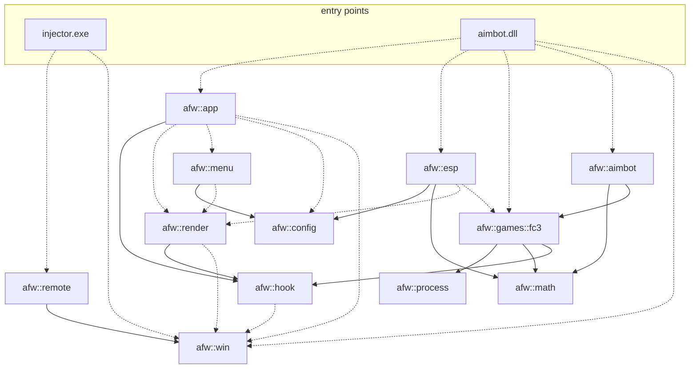
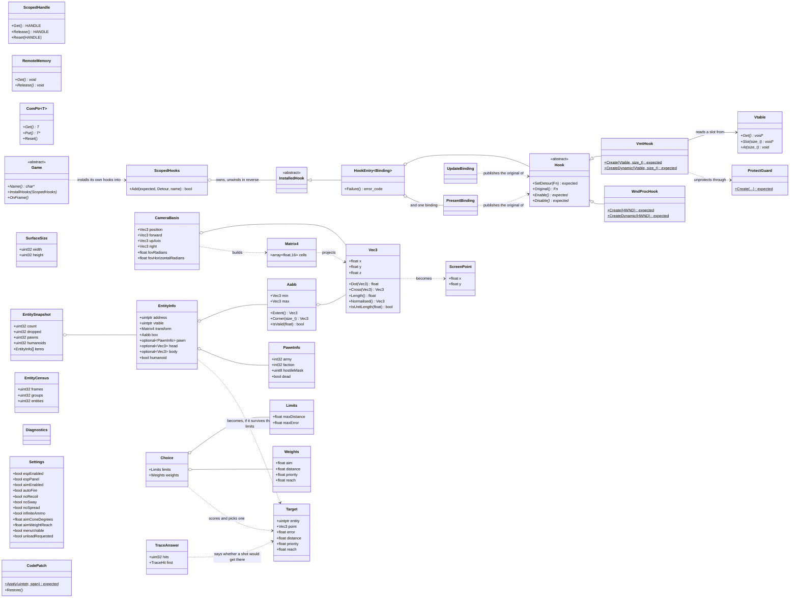

# AimbotFramework

A personal C++23 project for learning the Windows API, reverse-engineering and
3D geometry, using a single-player copy of **Far Cry 3** (Dunia engine) as the
subject.

The pipeline works end to end: `injector.exe` loads `aimbot.dll` into the running
game, the DLL hooks `IDXGISwapChain::Present` and the engine's per-frame entity
walk, draws an ImGui overlay over the frame, reads the game's live camera and
projects world entities into screen boxes. On top of that sits the aim assist —
it picks a target by a weighted score, steers the view onto a bone, and can pull
the trigger — and a set of byte patches that take recoil, sway, spread and the
empty-magazine check out of the game while their toggles are held down. The
overlay takes input, every feature can be switched off from its menu, and the DLL
can unload itself again, putting the game's own bytes back as it goes.

`afw` = **A**imbot**F**rame**w**ork (namespace / target prefix).


Everything in that frame except the game is drawn by the injected DLL: the menu
on the right, the boxes over the men down the road and over the one behind the
rock in the foreground, the smaller cube inside each of them marking where a
shot would actually go, and the green marker at the centre standing two metres
straight ahead to prove the projection honest.

The menu is the whole feature set in one column — what to draw, what to patch,
what to aim at — and under it the four weights the target choice is made of. In
this shot reachability is at 1.00 against 0.64 for the other three together,
which is what makes a man behind cover lose to one in the open however well
placed he is. The diagnostics panel is unticked, so it is not drawn at all.

## Status

Implemented:

- **`afw::win`** — RAII over raw Win32 and COM resources: `ScopedHandle`
  (`CloseHandle`), `RemoteMemory` (`VirtualFreeEx` in another process),
  `ProtectGuard` (`VirtualProtectEx`, restores the previous protection),
  `ComPtr` (COM `Release`), and `LastError()` turning `GetLastError` into a
  `std::error_code`.
- **`afw::remote`** — find a process by image name and inject a DLL into it via
  the classic CreateRemoteThread + LoadLibraryW technique. Success is decided by
  the remote thread's exit code, not by the API call returning.
- **`afw::hook`** — `Vtable` names the layout of a virtual method table and hands
  out the address of a slot; `VmtHook` swaps one such slot and `WndProcHook`
  swaps a window procedure through `SetWindowLongPtrW`. Both put the original
  back on destruction, and both capture it at construction, so a detour that
  chains to it can be published before anything is ever written. Both implement
  the same `Hook` interface — `SetDetour` and `Original` are non-virtual
  templates over a virtual raw operation — which is what lets hooks of different
  kinds be held together. Each has two factories: `Create` for a hook that lives
  in one scope, `CreateDynamic` for one that has to outlive it. The second
  exists because the hooks are deliberately not movable: they own a patched slot,
  and two live copies would both try to restore it. `CodePatch` is the same idea
  one level down — bytes written over the game's own instructions and put back
  when it goes away, so a setting that is switched off leaves nothing behind.
- **`afw::process`** — module bases and reads that report an unreadable address
  instead of faulting: a wrong offset becomes a `std::error_code`, not a crash in
  the host process. `FindPattern` locates code by a masked byte signature over
  the module's own image, which is what lets a patch survive a different build of
  the game where a number lifted out of a decompiler would not.
- **`afw::render`** — obtains the swap chain vtable from a throwaway WARP probe,
  owns the `Present` binding, and draws the ImGui overlay, offering its users a
  per-frame callback.
- **`afw::esp`** — world-to-screen: view and projection matrices built by hand,
  `w`-clipping for points behind the camera, entity boxes from the eight
  projected corners of an object-space AABB, plus a diagnostics panel showing
  every address, offset and matrix input in play.
- **`afw::games::fc3`** — Far Cry 3 bindings: the pointer chain to the live
  camera, its basis and field of view, the render viewport, and the per-frame
  walk over the engine's entity update groups. Every step is a checked read, and
  all addresses are rebased from the Ghidra image base at run time, so ASLR is
  handled in one place. On top of the reads it also:
  - reads the view angles the engine steers by, and writes all three copies it
    keeps — setting only the one it commits to leaves the next frame reading the
    old heading back out of another;
  - finds the skeleton and hands back the bones worth aiming at: the head on a
    man, the spine on an animal or a bird, whose own coordinates are nowhere near
    its body;
  - holds the four byte patches — recoil, sway, spread and the empty-magazine
    check — each found by signature and each explained where it lives, because a
    patch nobody can re-derive is a patch nobody can trust;
  - puts segments to the engine's own collision world and reads the answers back
    out of it, which is how a target behind cover is known to be behind cover.
- **`afw::math`** — `Vec3` and the algebra on it. It is also the wire format:
  the engine stores three consecutive floats wherever a point or an axis goes,
  so `afw::process::ReadAt` copies straight into it and nothing converts
  anywhere between reading the game's memory and projecting to the screen. That
  is what keeps it a trivially copyable aggregate — a constructor or a private
  member would silently change what every read returns.
- **`afw::aimbot`** — the aim assist, kept engine-agnostic: it is handed a
  snapshot and an eye, and holds no opinion about who is hostile. Candidates
  inside the cone are **scored, not merely filtered** — closeness to the aim,
  closeness in distance, what the caller thinks the kind is worth, and whether a
  shot would get there at all. Each term is a 0..1 nearness before its weight
  applies, so the weights are comparable and any of them may be zero; with only
  the first set it picks whoever the eye already points nearest to, which is
  what it did before there was a formula.
- **`afw::config`** — the toggles the menu writes and the ESP reads, so neither
  owns the other's state.
- **`afw::menu`** — the overlay's user interface and its message routing:
  `INSERT` shows and hides it, and while it is up the game does not see the
  input it consumes.
- **`afw::app`** — the injected DLL's whole session, with nothing title-specific
  in it: the file log, the `Present` and window-procedure hooks, the menu, the
  detour drain and the self-unload. `ScopedHooks` owns everything installed and
  takes it back off in reverse at scope exit; a title plugs in through
  `afw::app::Game` — its own hooks and its own per-frame drawing — and that is
  the seam a second title reuses unchanged.
- **`injector.exe`** / **`aimbot.dll`** — the working pair, verified in the game.
  The DLL is 30 lines: an entry point that starts a thread and hands one `Game`
  to `afw::app::Run`.

Skeleton — the header, target and empty namespace are in place, the code is not:

- **`afw::games::doom3`** — Doom 3 (id Tech 4). Chosen for **OpenGL**, and
  because its engine source is published: the structures do not have to be
  recovered from a disassembly first. Far Cry 3 cost months of that, and it is
  not what the project is for.
- **`afw::games::q2rtx`** — Quake II RTX (Q2PRO lineage). Chosen for **Vulkan**,
  and for the same reason: single-player, and the sources are there.

An inline/trampoline hook is still absent, and it turned out not to be needed:
the engine's per-frame entity walk is reached through a virtual call, so the
same `VmtHook` that intercepts `Present` intercepts it too.

### Milestones

| | | |
|---|---|---|
| M0 | 32-bit build, injection | done |
| M1 | RAII wrappers (`ProtectGuard`, `ComPtr`, `VmtHook`) | done |
| M2 | `Present` hook, frames counted, nothing drawn | done |
| M3 | first pixel: ImGui with both backends | done |
| M6 | geometry: a marker pinned to a world point | done |
| M7 | ESP: entity list to boxes | done |
| M4 | input: `WndProcHook`, overlay toggle | done |
| M8 | menu: ESP toggle, self-unload | done |
| M10 | `afw::app`: the session lifted out of `dllmain`, no title left in it | done |
| M5 | `ResizeBuffers` | not blocking — the render target view is rebuilt every frame |
| M9 | aim assist: target choice, view steering, auto-fire | done |
| M12 | byte patches: recoil, sway, spread, magazine | done |
| M13 | reachability through the engine's own collision world | done |
| M11 | OpenGL and Vulkan frame hooks; untie `esp` from one title | planned |

M6 was taken before M4 and M5 deliberately: the geometry is the part the project
exists to learn, and it needs neither input nor a cached render target.

### Direction

The ESP came before the aim assist, and that order paid. It exercises the whole
pipeline — locate entities, read memory, project to screen, draw — while staying
**read-only**, so a mistake shows up as a visual glitch rather than as corrupted
game memory. Only once that worked did anything start writing: view angles first,
then bytes over the game's own code, then calls into its collision world. Each of
those is a step further from "if I am wrong, a box lands in the wrong place".

The overlay stayed useful after that, in a way that was not the plan: it is how
the aim assist is debugged. The cube is drawn where the shot is going, not where
the entity is, and a target the collision world says is unreachable is drawn in
another colour — so "why did it shoot through a wall" is a question the screen
answers, rather than one the log has to.

The foundation is the frame loop, not the menu. Once `Present` is hooked there is
a per-frame callback holding a valid `ID3D11Device` / `ID3D11DeviceContext`;
`afw::menu` and `afw::esp` are **siblings** on top of it and never reference each
other, sharing state only through `afw::config`. That way the ESP runs with
settings alone and needs no user interface present, and the DLL shim is the only
place that knows both exist.

The next two titles are picked to put pressure on exactly the places that are
still tied to one renderer. Far Cry 3 is Direct3D 11, Doom 3 is OpenGL, Quake II
RTX is Vulkan — so `IDXGISwapChain::Present` stops being *the* frame hook and
becomes one of three, alongside `wglSwapBuffers` and `vkQueuePresentKHR`. Both
are single-player and long dead, which keeps the scope where the licence puts
it. Both also have published engine sources, which is a separate and purely
practical matter: the months Far Cry 3 took to recover from a disassembly are
not the part of this worth repeating. `afw::app` already carries no knowledge of
a title; `afw::esp` and `afw::aimbot` both still link `afw::games::fc3` directly
and have to be untied from it before the second title can draw or aim at
anything.

## Architecture

Libraries and the direction they depend in. Solid arrows are `PUBLIC` links,
dashed ones `PRIVATE` — a private edge is an implementation detail the consumer
does not inherit.



`afw::app` is the layer with no edge to any game: everything below it is either
generic or a title the DLL chooses at link time. `menu` and `esp` are siblings:
neither references the other, and they share state only through `config`, so the
ESP runs with no user interface present. `config` and `math` are the libraries
with no Win32 dependency, so they build everywhere — and they are the two whose
tests run on any platform.

The two edges that do not belong in that picture are `esp -.-> games::fc3` and
`aimbot --> games::fc3`. They are drawn because they are real, not because they
are right: both reach into one specific title for their entity list instead of
being handed one. The aim assist calls itself engine-agnostic and is, in its
arithmetic — angles, scores, weights — but its input type still has a game's name
on it, and that is the seam the second title will break.

The types themselves:



## Layout

```
CMakeLists.txt          root: options (AFW_*) and subdirectories
CMakePresets.json       UCRT64 and MINGW32 presets
cmake/                  ProjectOptions / Sanitizers / Coverage / Format / Tidy / Gtest
third_party/
  imgui/                Dear ImGui, git submodule pinned to a release tag
  CMakeLists.txt        its build file, kept outside the submodule
docs/
  images/               screenshots referenced from this file
include/afw/            public headers (sibling of src/)
  win/ remote/ hook/ process/ render/ esp/ menu/ app/ config/ math/ aimbot/
  games/fc3/                                                       implemented
  games/doom3/ games/q2rtx/                                          skeleton
src/
  win/ remote/ hook/ process/ render/ esp/ menu/ app/ aimbot/ games/fc3/
                                          STATIC, Windows-only
  config/ math/                           STATIC, platform-agnostic
  games/doom3/ games/q2rtx/               STATIC, skeleton
injector/
  injector.cpp          injector.exe -> loads aimbot.dll via afw::remote
dll/
  dllmain.cpp           entry point -> starts a thread, hands one Game to
                        afw::app::Run, and nothing else
  farcry3.cpp/.hpp      the Far Cry 3 Game: its entity-walk detour, the aim
                        assist and auto-fire, which patches are held, the
                        reachability queries and the status line
tests/                  GTest + CTest wiring
  scripts/              check_format.py / check_tidy.py (no bash dependency)
```

Dependency direction: `games::* -> process`; `render -> hook -> win`; `app` sits
on `render`, `menu` and `hook` and knows no game; `esp` and `aimbot` both sit
still on `games::fc3`; `menu` is `esp`'s sibling and they share `config`. No
library contains a Windows entry point.

`dll/` is flat because there is one title in it. Each title gets its own DLL —
the game is chosen at link time, never at run time — so a second one means a
second target, not a runtime switch.

`afw::process` reads this process's memory through the Win32 API, so it and the
libraries built on it (`games::*`, `aimbot`) are added only under `WIN32`;
`afw::config` and `afw::math` stay platform-agnostic.

## Target architecture

Far Cry 3's Direct3D 11 executable (`bin/farcry3_d3d11.exe`) is **32-bit**, and a
64-bit DLL cannot be loaded into a 32-bit process. `aimbot.dll` and
`injector.exe` therefore have to be built for x86 with an `i686-w64-mingw32`
toolchain (MSYS2 **MINGW32**); the library code itself is unaffected, and the
whole test suite passes on both architectures.

`-Wl,--high-entropy-va` requires a 64-bit image, so `cmake/ProjectOptions.cmake`
applies it only when `CMAKE_SIZEOF_VOID_P` is 8. `--dynamicbase` and
`--nxcompat` apply to both.

To confirm on your own copy, read `IMAGE_FILE_HEADER.Machine` from the PE header:
`0x014C` is x86, `0x8664` is x64.

## Getting the sources

Dear ImGui is a submodule, so a plain `git clone` leaves `third_party/imgui`
empty and the configure step stops with a message saying exactly this:

```sh
git clone --recurse-submodules <url>
# or, in an existing clone:
git submodule update --init --recursive
```

## Build (from an MSYS2 **UCRT64** shell)

`cmake`, `ninja` and `clang` live in UCRT64, not MINGW64.

```sh
# primary dev build: GCC, Debug, tests + DLL, no sanitizer
cmake --preset dev-debug
cmake --build --preset dev-debug
ctest --preset dev-debug

# release DLL only -> build/ci-release/dll/aimbot.dll
cmake --preset ci-release
cmake --build --preset ci-release
```

## Build 32-bit (from an MSYS2 **MINGW32** shell)

This is the build that runs in the game.

```sh
pacman -S --needed mingw-w64-i686-gcc mingw-w64-i686-gtest

cmake --preset dev-debug-x86
cmake --build --preset dev-debug-x86
ctest --preset dev-debug-x86

# and the pair that ships into the game
cmake --preset ci-release-x86
cmake --build --preset ci-release-x86
```

No toolchain paths are pinned anywhere: CMake picks up both the compiler and the
32-bit GTest from the shell's `PATH`, exactly as `dev-debug` does for the 64-bit
environment, so this works wherever MSYS2 is installed.

`cmake` and `ninja` are architecture-independent build drivers, but MINGW32 does
not ship them, so a bare MINGW32 shell fails the configure with *"unable to find
a build program corresponding to Ninja"*. Either install the 32-bit packages or,
simpler, put UCRT64 on `PATH` **after** MINGW32 so the compiler still resolves to
the 32-bit one:

```sh
export PATH="/c/msys64/mingw32/bin:/c/msys64/ucrt64/bin:$PATH"
export MSYSTEM=MINGW32
```

Running a preset from the wrong shell is a configure error rather than a silent
build of the other architecture: `dev-debug-x86` declares
`AFW_TARGET_POINTER_SIZE` and the top-level `CMakeLists.txt` checks it against
the compiler CMake actually found. Note that a **build** started from the wrong
shell fails differently: `cc1plus` cannot find its own DLLs and dies without
printing a diagnostic, so a compile that fails with no message is almost always
`PATH`, not the code.

The lint gate (`FormatCheck`, `TidyCheck`) is registered only in the 64-bit
build; clang-format and clang-tidy do not depend on the target architecture, so
running them twice would only cost time. The vendored ImGui is outside their file
globs and does not link `project_options`: the warning set is tuned for our own
code.

`aimbot.dll` is staged next to `injector.exe` by a build target of its own rather
than a `POST_BUILD` step, because a `POST_BUILD` command only runs when its own
target is relinked — a change confined to the DLL used to leave a stale copy
staged.

The staged copy is stripped of its debug information; the one in the build tree
keeps it. That is an address-space constraint, not a disk one. A PE is mapped at
its `SizeOfImage`, and DWARF takes that from 2.3 MB to 23.6 MB — the loader has
to find that as **one free run** inside a 32-bit game already holding a 37 MB
engine module and roughly 190 MB of display driver. Past about 20 MB the remote
`LoadLibraryW` starts returning NULL, which surfaces as the injector reporting a
missing module or a dependency failure rather than as anything about size.

The DLL output is `aimbot.dll` (no `lib` prefix), with the MinGW runtime linked
statically so it does not need MSYS2 runtime DLLs on the host's search path, and
PE hardening enabled (`--dynamicbase --nxcompat --high-entropy-va`).

## Running it

Start Far Cry 3 (the DirectX 11 executable), then run `injector.exe` from the
32-bit build.

| Key / control | Effect |
|---|---|
| `INSERT` | shows and hides the menu; while it is up the game does not see the input the overlay consumes |
| `MOUSE 4`, held | steers the view onto the chosen target for as long as it is down |
| `ESP` checkbox | draws the entity boxes, or nothing |
| `debug panel` | the diagnostics window; off by default, it is scaffolding |
| `aim boxes` | the cube marking where the shot is going — head on a man, spine on an animal |
| `no recoil` / `no sway` / `no spread` / `infinite magazine` | byte patches, held only while ticked |
| `auto fire` | pulls the trigger once the aim is inside its own cone |
| `Unload` button | takes every hook and every patch back off and unloads the DLL |

The aim settings are a cone, a range, a smoothing share, and the four weights the
target choice is made of. The weights are the interesting part: reachability can
be made to outrank everything else by giving it more than the other three can add
up to, and setting the rest to zero reduces the whole thing to "whoever is
nearest the crosshair".

The `debug panel` lists the whole camera pointer chain, the offsets it walked,
the camera basis, both fields of view, the entity census and the projected marker
positions — it is the first place to look when a box lands somewhere wrong, and
the reason the calibration markers in the screenshot exist.

The DLL also writes `aimbot.dll.log` next to itself — the injection steps, then a
status line every 1800 frames.

Patches deserve one warning of their own. They are byte writes over the game's
own instructions, found by signature rather than by address, and every one of
them is put back the moment its toggle goes off or the DLL unloads. That is the
whole safety story: nothing is patched permanently, and nothing is patched that
cannot be found again on a different build. The signatures and the reasoning
behind each patch live next to the offsets they use, in
`include/afw/games/fc3/internal/layout.hpp`, which is the one place in the
project where comments are not only allowed but the point.

Unloading restores the window procedure and both hooked slots in the reverse
order they went on, waits for the threads still inside a detour to leave, then
releases the ImGui contexts and calls `FreeLibraryAndExitThread`.

Two things make that safe, both learned the hard way, and both now live in one
place each so they cannot be got wrong again:

- Each hook is disabled **explicitly**, before the binding that publishes its
  original goes out of scope. Left to destruction order it happens the other way
  round, and in that window a detour finds no original to chain to — the entity
  update pass is skipped and `Present` returns without showing a frame. The order
  is now a property of `HookEntry`: `Disable()` runs in the destructor body, and
  the binding is declared after the hook, so it dies between the two.
- The threads are counted in and out of every detour, and the unload waits for
  that count to reach zero instead of sleeping a guessed interval. Restoring a
  slot stops new calls from entering; it says nothing about the calls already
  inside, and unmapping the module out from under one of them hangs the game.
  The counter is exact for a thread inside a detour body; the short settle after
  it covers the one gap it cannot — a thread that has read the slot but not yet
  reached the guard.

### Presets

64-bit, from UCRT64:

| Preset              | Type           | Notes                                  |
|---------------------|----------------|----------------------------------------|
| `dev-debug`         | Debug          | GCC, no sanitizer (default dev build)  |
| `dev-debug-asan`    | Debug          | ASan+UBSan, forces `clang++`           |
| `dev-debug-ubsan`   | Debug          | UBSan, forces `clang++`                |
| `ci-coverage`       | Debug          | gcov instrumentation                   |
| `ci-relwithdebinfo` | RelWithDebInfo | tests on                               |
| `ci-release`        | Release        | `aimbot.dll` only, tests off           |

32-bit, from MINGW32 — these are the ones that run in the game:

| Preset                  | Type           | Notes                                    |
|-------------------------|----------------|------------------------------------------|
| `dev-debug-x86`         | Debug          | the everyday build                       |
| `ci-relwithdebinfo-x86` | RelWithDebInfo | optimised, keeps symbols for stacks      |
| `ci-release-x86`        | Release        | the shipping pair, tests off             |

All three inherit a hidden `base-x86` that carries `AFW_TARGET_POINTER_SIZE=4`
and switches the lint gate off, so a new 32-bit preset cannot forget either.

> Thread/Memory sanitizers are intentionally absent: they do not exist on
> Windows for any toolchain. GCC ships no sanitizer runtime at all, so ASan/UBSan
> presets use Clang — and there are no 32-bit sanitizer presets for the same
> reason, one level worse: the 32-bit MinGW toolchain has no sanitizer runtime
> to point Clang at either. Coverage has no 32-bit preset because the source is
> the same and `ci-coverage` already measures it.

## Options

| Option                   | Default            | Meaning                          |
|--------------------------|--------------------|----------------------------------|
| `AFW_BUILD_DLL`          | ON (top-level+Win) | build `aimbot.dll`               |
| `AFW_BUILD_INJECTOR`     | ON (top-level+Win) | build `injector.exe`             |
| `AFW_BUILD_TESTS`        | ON (top-level)     | build the GTest suite            |
| `AFW_ENABLE_FORMAT_CHECK`| ON (top-level)     | register clang-format as a test  |
| `AFW_ENABLE_TIDY_CHECK`  | ON (top-level)     | register clang-tidy as a test    |
| `AFW_ENABLE_COVERAGE`    | OFF                | gcov targets (needs tests)       |

`AFW_TARGET_POINTER_SIZE` is not an option but a cache variable the presets set:
when present, the top-level `CMakeLists.txt` compares it against
`CMAKE_SIZEOF_VOID_P` and fails the configure if they disagree. Only
`dev-debug-x86` sets it, to `4`.

## License & scope

Educational Source-Available License (see `LICENSE`): view, study, compile and
modify for **educational, non-commercial** use, no warranty, no liability. For
single-player use only (Far Cry 3's online services are dead) — not for
multiplayer / anti-cheat evasion.
