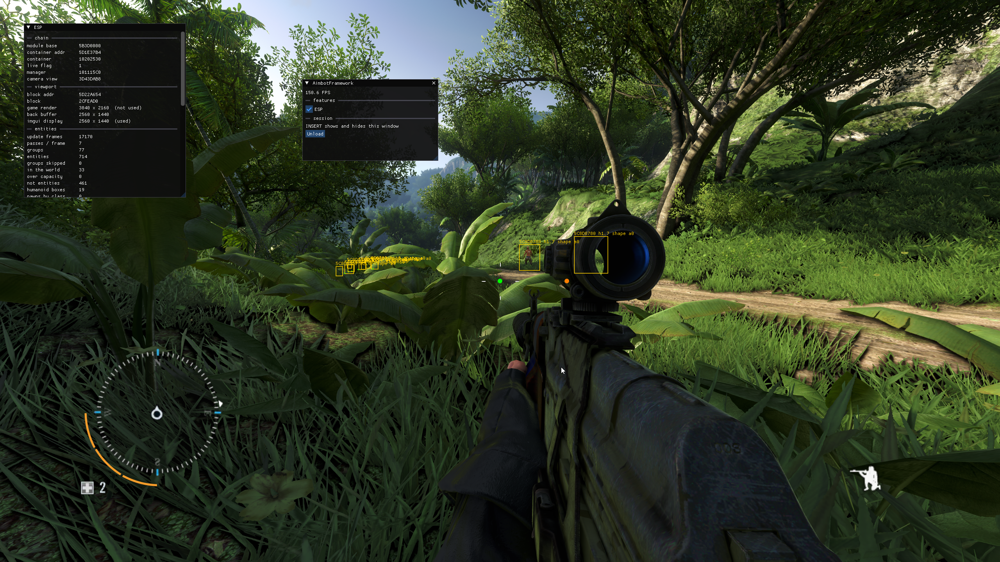
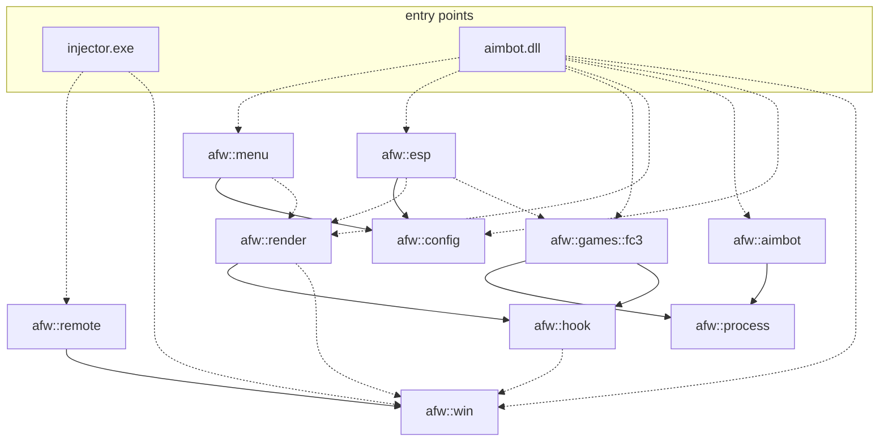
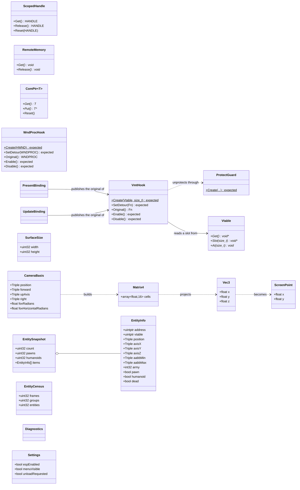

# AimbotFramework

A personal C++23 project for learning the Windows API, reverse-engineering and
3D geometry, using a single-player copy of **Far Cry 3** (Dunia engine) as the
subject.

The pipeline works end to end: `injector.exe` loads `aimbot.dll` into the running
game, the DLL hooks `IDXGISwapChain::Present` and the engine's per-frame entity
walk, draws an ImGui overlay over the frame, reads the game's live camera and
projects world entities into screen boxes. The overlay takes input, the ESP can
be switched off from its menu, and the DLL can unload itself again. What is left
is the aim assist on top of it.

`afw` = **A**imbot**F**rame**w**ork (namespace / target prefix).



Everything in that frame is drawn by the injected DLL: the `ESP` panel on the
left with the camera pointer chain and the entity census, the menu with the
feature toggle and the unload button, the boxes over the entities down the road,
and the two calibration markers at the centre — green two metres straight ahead,
orange two metres to the right at ten.

## Status

Implemented:

- **`afw::win`** — RAII over raw Win32 and COM resources: `ScopedHandle`
  (`CloseHandle`), `RemoteMemory` (`VirtualFreeEx` in another process),
  `ProtectGuard` (`VirtualProtectEx`, restores the previous protection),
  `ComPtr` (COM `Release`), and `LastError()` turning `GetLastError` into a
  `std::error_code`.
- **`afw::remote`** — find a process by image name and inject a DLL into it via
  the classic CreateRemoteThread + LoadLibraryW technique. Success is decided by
  the remote thread's exit code, not by the API call returning.
- **`afw::hook`** — `Vtable` names the layout of a virtual method table and hands
  out the address of a slot; `VmtHook` swaps one such slot and `WndProcHook`
  swaps a window procedure through `SetWindowLongPtrW`. Both put the original
  back on destruction, and both capture it at construction, so a detour that
  chains to it can be published before anything is ever written.
- **`afw::process`** — module bases and reads that report an unreadable address
  instead of faulting: a wrong offset becomes a `std::error_code`, not a crash in
  the host process.
- **`afw::render`** — obtains the swap chain vtable from a throwaway WARP probe,
  owns the `Present` binding, and draws the ImGui overlay, offering its users a
  per-frame callback.
- **`afw::esp`** — world-to-screen: view and projection matrices built by hand,
  `w`-clipping for points behind the camera, entity boxes from the eight
  projected corners of an object-space AABB, plus a diagnostics panel showing
  every address, offset and matrix input in play.
- **`afw::games::fc3`** — Far Cry 3 bindings: the pointer chain to the live
  camera, its basis and field of view, the render viewport, and the per-frame
  walk over the engine's entity update groups. Every step is a checked read, and
  all addresses are rebased from the Ghidra image base at run time, so ASLR is
  handled in one place.
- **`afw::config`** — the toggles the menu writes and the ESP reads, so neither
  owns the other's state. The only platform-agnostic library.
- **`afw::menu`** — the overlay's user interface and its message routing:
  `INSERT` shows and hides it, and while it is up the game does not see the
  input it consumes.
- **`injector.exe`** / **`aimbot.dll`** — the working pair, verified in the game.

Skeleton — the header, target and empty namespace are in place, the code is not:

- **`afw::aimbot`** — the aim-assist logic, kept engine-agnostic.

An inline/trampoline hook is still absent, and it turned out not to be needed:
the engine's per-frame entity walk is reached through a virtual call, so the
same `VmtHook` that intercepts `Present` intercepts it too.

### Milestones

| | | |
|---|---|---|
| M0 | 32-bit build, injection | done |
| M1 | RAII wrappers (`ProtectGuard`, `ComPtr`, `VmtHook`) | done |
| M2 | `Present` hook, frames counted, nothing drawn | done |
| M3 | first pixel: ImGui with both backends | done |
| M6 | geometry: a marker pinned to a world point | done |
| M7 | ESP: entity list to boxes | done |
| M4 | input: `WndProcHook`, overlay toggle | done |
| M8 | menu: ESP toggle, self-unload | done |
| M5 | `ResizeBuffers` | not blocking — the render target view is rebuilt every frame |
| M9 | aim assist | next |

M6 was taken before M4 and M5 deliberately: the geometry is the part the project
exists to learn, and it needs neither input nor a cached render target.

### Direction

The ESP comes before the aim assist. It exercises the whole pipeline — locate
entities, read memory, project to screen, draw — while staying **read-only**, so
a mistake shows up as a visual glitch rather than as corrupted game memory. The
aim assist adds angle solving and writes into another process, which is a
separate class of problem and is cheaper to approach once the pipeline works.

The foundation is the frame loop, not the menu. Once `Present` is hooked there is
a per-frame callback holding a valid `ID3D11Device` / `ID3D11DeviceContext`;
`afw::menu` and `afw::esp` are **siblings** on top of it and never reference each
other, sharing state only through `afw::config`. That way the ESP runs with
settings alone and needs no user interface present, and the DLL shim is the only
place that knows both exist.

## Architecture

Libraries and the direction they depend in. Solid arrows are `PUBLIC` links,
dashed ones `PRIVATE` — a private edge is an implementation detail the consumer
does not inherit.



`menu` and `esp` are siblings: neither references the other, and they share
state only through `config`, so the ESP runs with no user interface present.
`config` is the one library with no Win32 dependency, so it builds everywhere.

The types themselves:



## Layout

```
CMakeLists.txt          root: options (AFW_*) and subdirectories
CMakePresets.json       UCRT64 and MINGW32 presets
cmake/                  ProjectOptions / Sanitizers / Coverage / Format / Tidy / Gtest
third_party/
  imgui/                Dear ImGui, git submodule pinned to a release tag
  CMakeLists.txt        its build file, kept outside the submodule
docs/
  images/               screenshots referenced from this file
include/afw/            public headers (sibling of src/)
  win/ remote/ hook/ process/ render/ esp/ menu/ config/ games/fc3/  implemented
  aimbot/                                                            skeleton
src/
  win/ remote/ hook/ process/ render/ esp/ menu/ games/fc3/  STATIC, Windows-only
  config/                                 STATIC, platform-agnostic
  aimbot/                                 STATIC, skeleton
injector/
  injector.cpp          injector.exe -> loads aimbot.dll via afw::remote
dll/
  dllmain.cpp           entry point -> hooks Present, the entity walk and the
                        window procedure, then waits for the unload request
tests/                  GTest + CTest wiring
  scripts/              check_format.py / check_tidy.py (no bash dependency)
```

Dependency direction: `games::* -> process`; `render -> hook -> win`; `esp` sits
on `render` and `games::fc3`; `menu` is its sibling and they share `config`. No
library contains a Windows entry point.

`afw::process` reads this process's memory through the Win32 API, so it and the
libraries built on it (`games::*`, `aimbot`) are added only under `WIN32`;
`afw::config` stays platform-agnostic.

## Target architecture

Far Cry 3's Direct3D 11 executable (`bin/farcry3_d3d11.exe`) is **32-bit**, and a
64-bit DLL cannot be loaded into a 32-bit process. `aimbot.dll` and
`injector.exe` therefore have to be built for x86 with an `i686-w64-mingw32`
toolchain (MSYS2 **MINGW32**); the library code itself is unaffected, and the
whole test suite passes on both architectures.

`-Wl,--high-entropy-va` requires a 64-bit image, so `cmake/ProjectOptions.cmake`
applies it only when `CMAKE_SIZEOF_VOID_P` is 8. `--dynamicbase` and
`--nxcompat` apply to both.

To confirm on your own copy, read `IMAGE_FILE_HEADER.Machine` from the PE header:
`0x014C` is x86, `0x8664` is x64.

## Getting the sources

Dear ImGui is a submodule, so a plain `git clone` leaves `third_party/imgui`
empty and the configure step stops with a message saying exactly this:

```sh
git clone --recurse-submodules <url>
# or, in an existing clone:
git submodule update --init --recursive
```

## Build (from an MSYS2 **UCRT64** shell)

`cmake`, `ninja` and `clang` live in UCRT64, not MINGW64.

```sh
# primary dev build: GCC, Debug, tests + DLL, no sanitizer
cmake --preset dev-debug
cmake --build --preset dev-debug
ctest --preset dev-debug

# release DLL only -> build/ci-release/dll/aimbot.dll
cmake --preset ci-release
cmake --build --preset ci-release
```

## Build 32-bit (from an MSYS2 **MINGW32** shell)

This is the build that runs in the game.

```sh
pacman -S --needed mingw-w64-i686-gcc mingw-w64-i686-gtest

cmake --preset dev-debug-x86
cmake --build --preset dev-debug-x86
ctest --preset dev-debug-x86

# and the pair that ships into the game
cmake --preset ci-release-x86
cmake --build --preset ci-release-x86
```

No toolchain paths are pinned anywhere: CMake picks up both the compiler and the
32-bit GTest from the shell's `PATH`, exactly as `dev-debug` does for the 64-bit
environment, so this works wherever MSYS2 is installed.

`cmake` and `ninja` are architecture-independent build drivers, but MINGW32 does
not ship them, so a bare MINGW32 shell fails the configure with *"unable to find
a build program corresponding to Ninja"*. Either install the 32-bit packages or,
simpler, put UCRT64 on `PATH` **after** MINGW32 so the compiler still resolves to
the 32-bit one:

```sh
export PATH="/c/msys64/mingw32/bin:/c/msys64/ucrt64/bin:$PATH"
export MSYSTEM=MINGW32
```

Running a preset from the wrong shell is a configure error rather than a silent
build of the other architecture: `dev-debug-x86` declares
`AFW_TARGET_POINTER_SIZE` and the top-level `CMakeLists.txt` checks it against
the compiler CMake actually found. Note that a **build** started from the wrong
shell fails differently: `cc1plus` cannot find its own DLLs and dies without
printing a diagnostic, so a compile that fails with no message is almost always
`PATH`, not the code.

The lint gate (`FormatCheck`, `TidyCheck`) is registered only in the 64-bit
build; clang-format and clang-tidy do not depend on the target architecture, so
running them twice would only cost time. The vendored ImGui is outside their file
globs and does not link `project_options`: the warning set is tuned for our own
code.

`aimbot.dll` is staged next to `injector.exe` by a build target of its own rather
than a `POST_BUILD` step, because a `POST_BUILD` command only runs when its own
target is relinked — a change confined to the DLL used to leave a stale copy
staged.

The staged copy is stripped of its debug information; the one in the build tree
keeps it. That is an address-space constraint, not a disk one. A PE is mapped at
its `SizeOfImage`, and DWARF takes that from 2.3 MB to 23.6 MB — the loader has
to find that as **one free run** inside a 32-bit game already holding a 37 MB
engine module and roughly 190 MB of display driver. Past about 20 MB the remote
`LoadLibraryW` starts returning NULL, which surfaces as the injector reporting a
missing module or a dependency failure rather than as anything about size.

The DLL output is `aimbot.dll` (no `lib` prefix), with the MinGW runtime linked
statically so it does not need MSYS2 runtime DLLs on the host's search path, and
PE hardening enabled (`--dynamicbase --nxcompat --high-entropy-va`).

## Running it

Start Far Cry 3 (the DirectX 11 executable), then run `injector.exe` from the
32-bit build.

| Key / control | Effect |
|---|---|
| `INSERT` | shows and hides the menu; while it is up the game does not see the input the overlay consumes |
| `ESP` checkbox | draws the entity boxes and the diagnostics panel, or neither |
| `Unload` button | takes every hook back off and unloads the DLL from the running game |

The `ESP` panel lists the whole camera pointer chain, the offsets it walked, the
camera basis, both fields of view, the entity census and the projected marker
positions — it is the first place to look when a box lands somewhere wrong.

The DLL also writes `aimbot.dll.log` next to itself — the injection steps, then a
status line every 1800 frames.

Unloading restores the window procedure and both hooked slots in the reverse
order they went on, waits for the threads still inside a detour to leave, then
releases the ImGui contexts and calls `FreeLibraryAndExitThread`.

Two things make that safe, and both had to be learned the hard way:

- Each hook is disabled **explicitly**, before the binding that publishes its
  original goes out of scope. Left to destruction order it happens the other way
  round, and in that window a detour finds no original to chain to — the entity
  update pass is skipped and `Present` returns without showing a frame.
- The threads are counted in and out of every detour, and the unload waits for
  that count to reach zero instead of sleeping a guessed interval. Restoring a
  slot stops new calls from entering; it says nothing about the calls already
  inside, and unmapping the module out from under one of them hangs the game.

### Presets

64-bit, from UCRT64:

| Preset              | Type           | Notes                                  |
|---------------------|----------------|----------------------------------------|
| `dev-debug`         | Debug          | GCC, no sanitizer (default dev build)  |
| `dev-debug-asan`    | Debug          | ASan+UBSan, forces `clang++`           |
| `dev-debug-ubsan`   | Debug          | UBSan, forces `clang++`                |
| `ci-coverage`       | Debug          | gcov instrumentation                   |
| `ci-relwithdebinfo` | RelWithDebInfo | tests on                               |
| `ci-release`        | Release        | `aimbot.dll` only, tests off           |

32-bit, from MINGW32 — these are the ones that run in the game:

| Preset                  | Type           | Notes                                    |
|-------------------------|----------------|------------------------------------------|
| `dev-debug-x86`         | Debug          | the everyday build                       |
| `ci-relwithdebinfo-x86` | RelWithDebInfo | optimised, keeps symbols for stacks      |
| `ci-release-x86`        | Release        | the shipping pair, tests off             |

All three inherit a hidden `base-x86` that carries `AFW_TARGET_POINTER_SIZE=4`
and switches the lint gate off, so a new 32-bit preset cannot forget either.

> Thread/Memory sanitizers are intentionally absent: they do not exist on
> Windows for any toolchain. GCC ships no sanitizer runtime at all, so ASan/UBSan
> presets use Clang — and there are no 32-bit sanitizer presets for the same
> reason, one level worse: the 32-bit MinGW toolchain has no sanitizer runtime
> to point Clang at either. Coverage has no 32-bit preset because the source is
> the same and `ci-coverage` already measures it.

## Options

| Option                   | Default            | Meaning                          |
|--------------------------|--------------------|----------------------------------|
| `AFW_BUILD_DLL`          | ON (top-level+Win) | build `aimbot.dll`               |
| `AFW_BUILD_INJECTOR`     | ON (top-level+Win) | build `injector.exe`             |
| `AFW_BUILD_TESTS`        | ON (top-level)     | build the GTest suite            |
| `AFW_ENABLE_FORMAT_CHECK`| ON (top-level)     | register clang-format as a test  |
| `AFW_ENABLE_TIDY_CHECK`  | ON (top-level)     | register clang-tidy as a test    |
| `AFW_ENABLE_COVERAGE`    | OFF                | gcov targets (needs tests)       |

`AFW_TARGET_POINTER_SIZE` is not an option but a cache variable the presets set:
when present, the top-level `CMakeLists.txt` compares it against
`CMAKE_SIZEOF_VOID_P` and fails the configure if they disagree. Only
`dev-debug-x86` sets it, to `4`.

## License & scope

Educational Source-Available License (see `LICENSE`): view, study, compile and
modify for **educational, non-commercial** use, no warranty, no liability. For
single-player use only (Far Cry 3's online services are dead) — not for
multiplayer / anti-cheat evasion.
